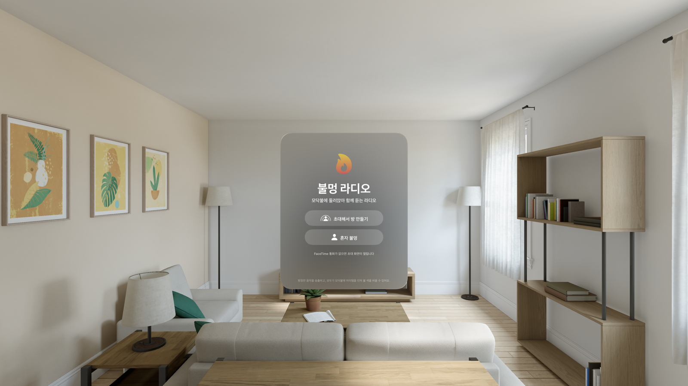
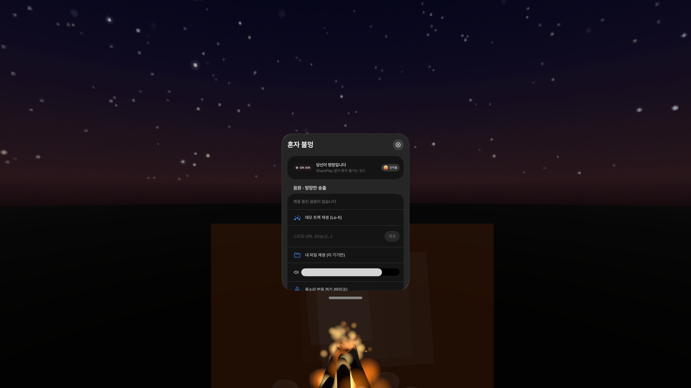
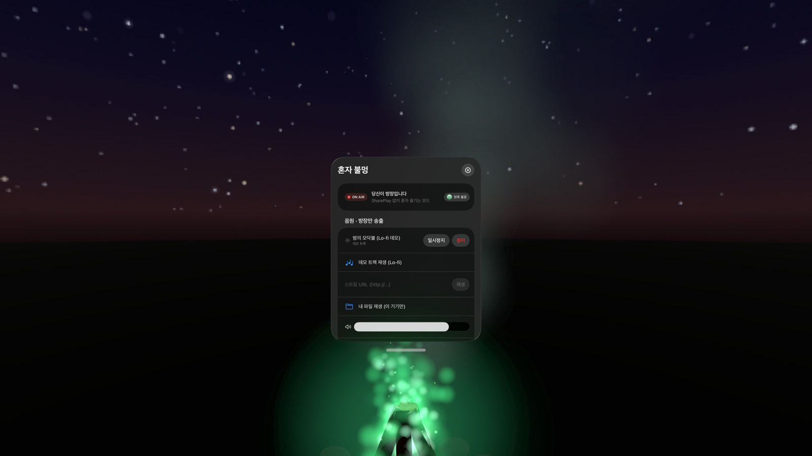
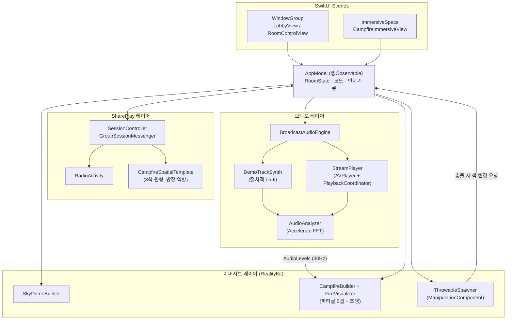
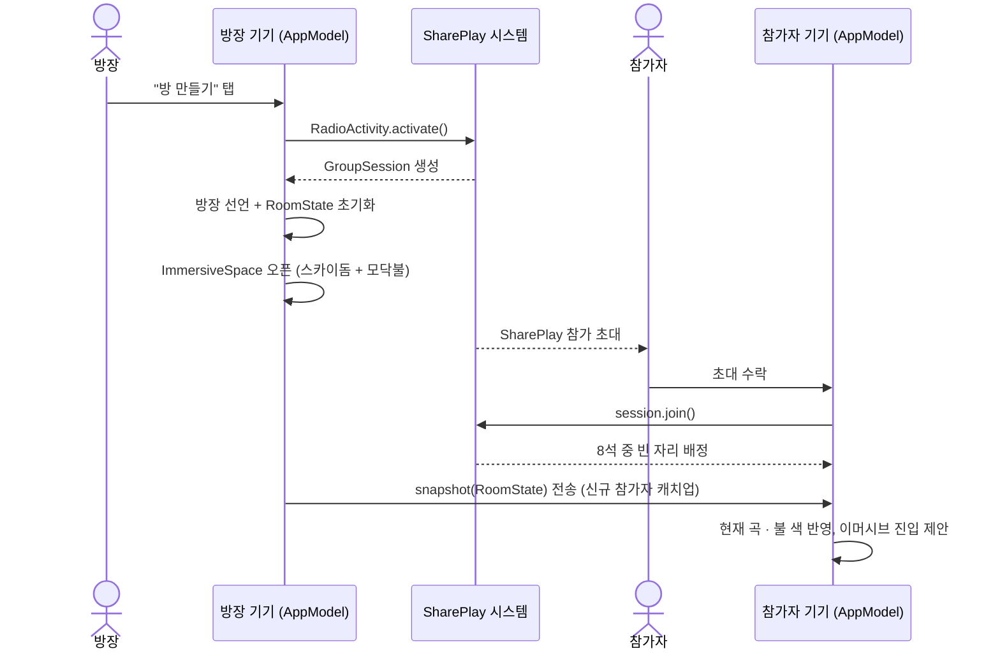
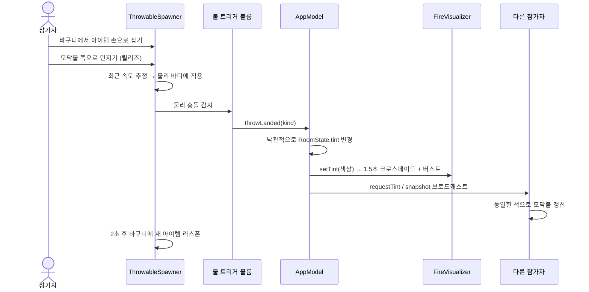

# 🔥 불멍 라디오 (Bonfire Radio)

**모닥불에 둘러앉아, 한 사람의 목소리와 음악을 함께 듣는 visionOS SharePlay 앱**

Apple Vision Pro를 쓴 사람들이 밤하늘 스카이돔 아래 모닥불을 중심으로 원형 좌석에 모여, 방장 한 명이 진행하는 라디오 방송(목소리 + 음악)을 함께 듣습니다. 모닥불은 재생 중인 소리에 실시간으로 반응하는 파티클 비주얼라이저이고, 누구나 모닥불에 아이템을 던져 불꽃의 색을 바꿀 수 있습니다.


---

## 스크린샷

| 로비 | 모닥불 (기본) | 모닥불 (아이템 던진 뒤) |
|---|---|---|
|  |  |  |
| 방 만들기 / 혼자 불멍 진입 화면 | 데모 트랙에 반응하는 기본 장작불 | 구리 조각을 던져 청록색으로 바뀐 불꽃 |

> 스크린샷은 visionOS 시뮬레이터에서 촬영했습니다. 실제 기기에서는 창이 손에 잡히듯 공간에 떠 있고, 모닥불 공간은 완전 몰입(Full Immersive)으로 열립니다.

---

## 주요 기능

- **방 만들기 & SharePlay** — 방을 만든 사람이 자동으로 방장이 되어, FaceTime 통화 중이면 즉시 방을 시작하고 아니면 시스템 공유 시트로 초대합니다.
- **8인 원형 좌석 배치** — `SpatialTemplate`으로 모닥불 주위에 반경 2.4m, 8석을 원형으로 배치하고 방장은 정면 좌석에 고정됩니다.
- **오디오 반응형 모닥불** — 코어 불꽃·외곽 불꽃·불씨·연기·광륜 5겹의 RealityKit 파티클이 FFT로 분석한 저·중·고역과 비트에 30Hz로 반응합니다.
- **던지기로 불 색 바꾸기** — 소금, 구리, 리튬 등 8가지 아이템을 손으로 잡아 모닥불에 던지면 화학 불꽃반응을 모티프로 한 색으로 1.5초간 전환됩니다.
- **방장 전용 송출** — 데모 트랙(절차적 Lo-fi 합성), 스트림 URL, 방장 로컬 파일 중에서 음원을 고르며, 재생·볼륨·불 색 초기화는 방장만 조작합니다.
- **혼자 불멍 모드** — SharePlay 없이도 마이크 목소리에 반응하는 모닥불을 혼자 즐길 수 있습니다.

---

## 아키텍처



**설계 원칙**
- **방장 권위(host-authoritative)**: 방 상태(`RoomState`)의 진실은 방장 기기에 있고, `seq` 값이 큰 스냅샷만 반영합니다.
- **로컬 우선 반응(optimistic UI)**: 아이템을 던지면 로컬에서 즉시 색을 바꾸고, 방장의 확정 스냅샷으로 최종 동기화합니다.
- **결정론적 오디오**: 데모 트랙은 곡 시간의 순수 함수라서 시작 시각만 공유하면 모든 기기가 같은 소리를 냅니다.

---

## 동작 흐름

### 1. 방 만들기 → SharePlay 참가 → 이머시브 진입



### 2. 모닥불에 아이템 던지기



---

## 기술 스택

| 영역 | 기술 |
|---|---|
| UI / 씬 관리 | SwiftUI (`WindowGroup`, `ImmersiveSpace`), `@Observable` |
| 3D / 파티클 / 물리 | RealityKit (`ParticleEmitterComponent`, `ManipulationComponent`, `PhysicsBodyComponent`, `PointLightComponent`) |
| 공동 시청 | GroupActivities (`GroupActivity`, `SpatialTemplate`, `GroupSessionMessenger`, `SystemCoordinator`) |
| 오디오 재생/분석 | AVFAudio (`AVAudioEngine`, `AVAudioSourceNode`, `AVPlayer` + `AVPlayerPlaybackCoordinator`), Accelerate (`vDSP` FFT) |
| 절차적 텍스처 | CoreGraphics (밤하늘 그라데이션 + 별 생성) |

---

## 프로젝트 구조

```
Bonfire Radio/
├── Bonfire Radio.xcodeproj
├── Bonfire Radio/
│   ├── MyApp.swift                    # @main 앱 진입점, Scene 정의
│   ├── Model/
│   │   ├── AppModel.swift             # 전역 상태, 방장 권위 로직
│   │   ├── RoomState.swift            # 공유 상태 · 메시지 정의
│   │   ├── FlameTint.swift            # 불 색 팔레트 9종
│   │   └── ThrowableKind.swift        # 던지기 아이템 8종
│   ├── SharePlay/
│   │   ├── RadioActivity.swift
│   │   ├── CampfireSpatialTemplate.swift
│   │   └── SessionController.swift
│   ├── Audio/
│   │   ├── BroadcastAudioEngine.swift
│   │   ├── DemoTrackSynth.swift
│   │   ├── StreamPlayer.swift
│   │   └── AudioAnalyzer.swift
│   ├── Immersive/
│   │   ├── SkyDomeBuilder.swift
│   │   ├── CampfireBuilder.swift
│   │   ├── FireVisualizer.swift
│   │   ├── ThrowableSpawner.swift
│   │   └── CampfireImmersiveView.swift
│   └── Views/
│       ├── LobbyRootView.swift / LobbyView.swift
│       ├── RoomControlView.swift
│       └── NowPlayingLabel.swift
└── Docs/
    ├── DesignPRD.md                    # 디자인 PRD (한글)
    ├── TechPRD.md                      # 테크 PRD (한글)
    ├── Tasks.md                        # 태스크 진행 현황
    └── screenshots/
```

---

## 시작하기

### 요구 사항
- Xcode 27 이상
- visionOS 27 SDK
- Apple Vision Pro 또는 visionOS 시뮬레이터

### 빌드 & 실행
1. `Bonfire Radio.xcodeproj`를 Xcode로 엽니다.
2. 스킴을 `Bonfire Radio`로 두고, 실행 대상을 시뮬레이터 또는 실기기로 선택합니다.
3. ⌘R로 실행합니다. 로비에서 **혼자 불멍**을 선택하면 SharePlay 없이 바로 모닥불 공간을 체험할 수 있습니다.

### 시뮬레이터에서 빠르게 확인하기
DEBUG 빌드에는 런치 인자로 자동 진입하는 훅이 있습니다.

```bash
xcrun simctl launch <UDID> com.coulson.BonfireRadio autosolo autodemo
# autosolo  : 혼자 불멍 모드로 즉시 진입
# autodemo  : 데모 Lo-fi 트랙 자동 재생
# autothrow : 3초 뒤 구리 조각을 자동으로 던져 불 색 전환 테스트
```

### SharePlay(방 만들기) 활성화하기
현재 서명에 쓰는 개인(무료) Apple Developer 팀은 **Group Activities 권한을 지원하지 않아** SharePlay 기능이 프로비저닝 단계에서 막힙니다. 그래서 기본 `Bonfire Radio.entitlements`는 해당 권한을 비워 두었고, 실제 키는 `Bonfire Radio.SharePlay.entitlements`에 보관해 두었습니다.

유료 Apple Developer Program 팀으로 전환한 뒤:
1. 타깃 **Build Settings → Signing → Code Signing Entitlements** 값을 `Bonfire Radio/Bonfire Radio.SharePlay.entitlements`로 변경합니다.
2. 다시 빌드하면 "방 만들기"로 실제 SharePlay 세션을 시작할 수 있습니다.

그 전까지는 **혼자 불멍** 모드로 모든 시각·오디오 기능을 테스트할 수 있습니다.

---

## 알려진 제약 사항

- **다른 앱의 소리를 가져올 수 없음** — visionOS 샌드박스 정책상 타 앱/시스템 오디오를 캡처할 수 없습니다. 그래서 "음악 송출"은 앱 내 플레이어(데모 트랙 / 스트림 URL / 방장 로컬 파일)로 구현했습니다.
- **참가자 마이크를 앱이 제어할 수 없음** — SharePlay 음성은 FaceTime이 담당합니다. 앱은 방장에게만 송출 컨트롤을 노출하고, 청취자에게는 마이크를 꺼 달라는 안내만 표시합니다.
- **개인 개발자 팀은 SharePlay 불가** — 위 "SharePlay 활성화하기" 항목 참고.
- **공간 페르소나 표시 인원 제한** — 시스템이 동시에 배치하는 공간 페르소나 수에 실질적 한계가 있을 수 있어, 8석을 정의해도 일부는 FaceTime 창으로 보일 수 있습니다.

더 자세한 배경은 [`Docs/DesignPRD.md`](Docs/DesignPRD.md)의 "알려진 플랫폼 제약" 절과 [`Docs/TechPRD.md`](Docs/TechPRD.md)의 리스크 표를 참고하세요.

---

## 문서

| 문서 | 내용 |
|---|---|
| [Docs/DesignPRD.md](Docs/DesignPRD.md) | 제품 비전, 사용자 시나리오, 공간·UI 디자인, 접근성 |
| [Docs/TechPRD.md](Docs/TechPRD.md) | 아키텍처, 모듈 설계, 동기화 규칙, 성능 예산, 리스크 |
| [Docs/Tasks.md](Docs/Tasks.md) | 단계별 태스크 진행 현황 |

## 로드맵 (v2 후보)

- 자체 오디오 서버(WebRTC SFU)로 서버가 강제하는 방장 마이크/음악 송출 권한
- MusicKit 카탈로그 검색·재생
- 공개 방 목록 · 딥링크
- 던지기 궤적을 다른 참가자에게도 실시간 재현

---

## 라이선스

이 프로젝트는 [Apache License 2.0](LICENSE)으로 배포됩니다.
